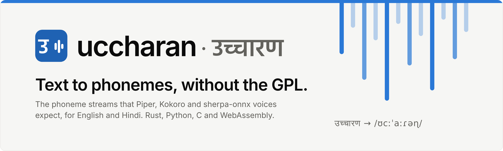

<p align="center">
  <picture>
    <source media="(prefers-color-scheme: dark)" srcset="docs/assets/brand/banner-dark.png">
    <source media="(prefers-color-scheme: light)" srcset="docs/assets/brand/banner-light.png">
    
  </picture>
</p>

<h3 align="center">5× faster than espeak-ng. Just as accurate. Free to ship.</h3>

<p align="center">
  A drop-in phonemiser for Piper, Kokoro and sherpa-onnx voices — English, Hindi, nineteen more
  South Asian languages, Spanish, French, German and Dutch, in Rust, Python, C and the browser. Apache-2.0.
</p>

<p align="center"><sub>
  espeak-ng is a speech synthesiser whose text-to-phoneme front end is what modern neural voices
  actually use; uccharan replaces that front end, and the neural voice does the speaking.
</sub></p>

<p align="center"><sub>
  <a href="docs/evaluation.md#5-speed-start-up-memory-and-size">12 µs vs 62 µs to turn a sentence into phonemes</a> ·
  <a href="docs/evaluation.md#2-end-to-end-real-voices-real-speech-recognition">same word error rate through Piper and Kokoro voices</a> ·
  <a href="DATA_LICENSES.md">no GPL anywhere</a>
</sub></p>

<p align="center">
  <a href="https://github.com/cB-Sigma/uccharan/actions/workflows/ci.yml"></a>
  <a href="LICENSE"></a>
  <a href="https://pypi.org/project/uccharan/"></a>
  <a href="https://crates.io/crates/uccharan"></a>
  <a href="https://www.npmjs.com/package/uccharan"></a>
</p>

<p align="center">
  <a href="https://cb-sigma.github.io/uccharan/"></a>
</p>

**uccharan** (उच्चारण, "pronunciation") turns text into the phoneme streams that neural
text-to-speech voices expect — for **English (US and British), Hindi, code-mixed Hindi + English, Spanish, French, German, Dutch and nineteen more South Asian
languages** (see [Measured compatibility](#measured-compatibility)) — under the Apache-2.0 licence, with no GPL code or data. It is written in Rust and runs
from Python, JavaScript (WebAssembly, in the browser and Node), Rust and C.

Most open voices (Piper, Kokoro, Kitten TTS, Matcha-TTS, StyleTTS2) were trained on phonemes from
espeak-ng, which is GPL-licensed. sherpa-onnx 2.0 removed espeak-ng for that reason and now expects
the caller to bring phonemes. uccharan is that phonemizer:

- **Compatible mode matches espeak-ng** closely enough that existing voices work unchanged:
  1.16 % phoneme disagreement on held-out American English, 0.09 % on Hindi, and the same
  speech-recognition word error rate when real voices speak its output ([numbers](#measured-compatibility)).
- **Improved mode is more correct than espeak-ng**: homographs in context, names, numbers, Hindi
  schwa deletion and nasals — 82.0 % against espeak-ng's 51.6 % on a hand-made test set written
  after the rules were frozen, 91.3 % against 61.6 % on held-out personal names of many origins
  (Indian names 79.2 % against 43.8 %), 75.9 % against 45.6 % on 195 held-out African names,
  and 69.4 % against 56.5 % on 85 held-out Egyptian names
  ([numbers](#correctness-improved-mode)).
- **Both are faster**: 5× lower latency and 5× higher throughput than espeak-ng for English,
  2.8× for Hindi, about 6× faster start-up, and it scales across threads ([numbers](#speed)).
- **Kokoro English**: a port of misaki, the front end Kokoro was trained on, with its dictionaries
  built in, matching it on 94.9 % of sentences at 90× its speed.

<p align="center">
  
</p>

## Quick start

**Python** (3.9+, Linux, macOS, Windows)

```sh
pip install uccharan
```

```python
import uccharan

uccharan.phonemize("Hello, world.")                         # 'həlˈoʊ, wˈɜːld.'
uccharan.phonemize("नमस्ते दुनिया", lang="hi")                 # 'nəmˈʌsteː dˈʊnɪjˌaː'
uccharan.phonemize("I read it yesterday.", improved=True)   # 'aɪ ɹˈɛd ɪt jˈɛstɚdˌeɪ.'

# sherpa-onnx >= 2.0: one list of codepoints per sentence
config.phoneme_codepoints = uccharan.phonemize(text, tts.lang, "sherpa-onnx")
```

**JavaScript** (browser or Node 18+)

```sh
npm install uccharan
```

```js
import { phonemize } from "uccharan";
await phonemize("Hello, world.");                          // "həlˈoʊ, wˈɜːld."
await phonemize("Hi there. Bye!", { profile: "piper" });   // ["hˈaɪ ðˈɛɹ.", "bˈaɪ!"]
```

**Rust**

```sh
cargo add uccharan
```

```rust
use uccharan::{Lang, Options, Phonemizer};
let p = Phonemizer::new();
assert_eq!(p.phonemize("Hello, world.", &Options::new(Lang::EnUs)), "həlˈoʊ, wˈɜːld.");
```

**C** (`libuccharan` + `uccharan.h` from the release page, or `cargo build --release -p uccharan-capi`)

```c
#include "uccharan.h"
UccharanPhonemizer *p = uccharan_new();
char *ipa = uccharan_phonemize(p, "Hello, world.", "en-us", "espeak-ipa", 0);
uccharan_string_free(ipa);
uccharan_free(p);
```

**Command line**: `uccharan -l hi -p piper "नमस्ते दुनिया।"`. Code written for `phonemizer` can use
`from uccharan.compat import EspeakBackend`.

## Text voices and word lists

**Normalise-only mode** gives voices that read text (Indic Parler-TTS, IndicF5, Chatterbox,
VoxCPM2, Veena and other LLM-based models) the spoken form of a text, with typed spans
(number, money, date, time, phone, URL, Latin word in Indic text, …) aligned to the input in
byte, code-point and UTF-16 offsets. Options choose which language reads digits, lakh/crore or
international grouping in English, whether Latin words are kept, respelled or spelled, and
whether URLs are read out.

```python
uccharan.normalize("₹5 करोड़ का सौदा 10:30 बजे", "hi").text   # 'पांच करोड़ रुपये का सौदा साढ़े दस बजे'
uccharan.normalize("UPI से भुगतान", "hi", latin="transliterate").text  # 'यू पी आई से भुगतान'
```

**Pronunciation word lists** (TSV with `word lang ipa say match note`, W3C PLS import and
export) apply to both kinds of voice: phoneme voices get the entry's IPA in their phone set,
text voices its spoken form or a respelling chosen by reading candidates back with uccharan.
See [docs/normalize.md](docs/normalize.md) and [docs/wordlists.md](docs/wordlists.md).

## Correcting speech-recognition output by sound

A recogniser writes a name it does not know as the nearest words it does know: "Kothari" as *Coat
Harry*, "Paytm" as *pay tm*. **Sound-alike matching** compares a transcript with your vocabulary
(names, products, jargon; a plain list or a [word list](docs/wordlists.md)) as phonemes and puts
the terms back. Close sounds are cheap to exchange (voicing, aspiration, vowel length,
retroflex / dental), unrelated ones are not, and because everything is phonemes a Latin-script
vocabulary matches a Devanagari transcript and the other way round.

```python
index = uccharan.SoundIndex(["Kothari", "Paytm", {"word": "nginx", "say": "engine X"}])
fixed = index.apply("send it to Coat Harry", "en-us")
fixed.text                                          # 'send it to Kothari'
[(c.old, c.new, c.score) for c in fixed.changes]    # every change is reported, nothing is silent
index.apply(text, "hi", confidence=word_confidences, max_confidence=0.6)  # only where the recogniser was unsure
uccharan.match_terms("कोठारी जी को फ़ोन करना है।", ["Kothari"], "hi")     # candidates only
```

Held-out, with 651 terms (Indian names, brands, technical and domain terms) in English, Hindi and
Hinglish sentences spoken by synthetic voices and transcribed by small recognisers: at the default
thresholds 43.9 % of the terms the recognisers got wrong are put back (64.2 % in English
sentences), 97.8 % of the corrections are right, and 2 of 775 sentences without any term are
changed. Character edit distance puts back 8.8 % (and changes 7 of those sentences); Metaphone
codes 18.7 % while changing 38 % of them. About 7 800 transcripts a second against 1 000
terms and 300 against 50 000. In Rust, Python, JavaScript, C and `uccharan --match-terms`; see
[docs/soundalike.md](docs/soundalike.md) and
[the evaluation](docs/evaluation.md#7-sound-alike-matching).

## Training your own voices

`uccharan.train` (Python) and the `uccharan-train` command are the front end for people who train
voices and check pronunciation. Nothing in it reads audio.

```sh
uccharan-train label metadata.csv -l hi --improved -o labels/        # phonemes for Piper, Matcha-TTS, icefall
uccharan-train select corpus.txt -l bho --improved -n 500 -o script/ # what to record
uccharan-train coverage labels/labels.jsonl -l hi --reference corpus.txt --alignments aligned/
uccharan-train score -l hi --reference "मेरा घोड़ा तेज़ है" --heard "मेरा कीड़ा तेज़ है"
uccharan-train mfa-dict corpus.txt -l bho -o bho.dict                # dictionary for a forced aligner
```

- **Labelling** turns a manifest (LJSpeech `metadata.csv`, JSON lines, Hugging Face rows) into
  Piper's `--data.phoneme_type text` CSV, a phoneme-id CSV and id map, Matcha-TTS filelists,
  `tokens.txt` and per-utterance token lists for icefall-style recipes, and a `voice.json` that
  records the uccharan version, mode, profile and language the voice must be driven with. Every
  symbol is one code point; symbols outside a target table (a base checkpoint's, for a warm
  start) are reported; each utterance gets warnings for unknown characters, unread numbers and
  mixed scripts. Word lists apply.
- **Script selection** picks the few sentences that cover every phone and as many diphones as
  possible (greedy set cover with length, digit, script and rare-symbol filters).
- **Coverage** counts phones and diphones, lists what a dataset lacks against a reference corpus,
  gives the duration per phone from alignments, and names outlier utterances.
- **Scoring** aligns a reference with a recogniser's text or a phone recogniser's output using the
  weighted phoneme distance of the sound-alike matcher, and reports the error rate, a score per
  word, and the words that were mispronounced, missing or extra: for text → voice → recogniser
  round trips and for language-learning feedback.

The file layouts were checked against the Piper, Matcha-TTS, icefall and Montreal Forced Aligner
sources and documentation; no voice has been trained with them yet. See
[docs/training.md](docs/training.md) and the [example](examples/train).

## Output profiles

| Profile | Gives you | For |
| --- | --- | --- |
| `espeak-ipa` | IPA string, words separated by spaces | anything that used `phonemizer`'s espeak backend |
| `piper` | one string per sentence; `piper_ids()` maps it through a voice's `phoneme_id_map` | Piper voices |
| `sherpa-onnx` | one codepoint list per sentence | sherpa-onnx ≥ 2.0 `phoneme_codepoints` |
| `kokoro` | Kokoro tokens; `kokoro_ids()` | Kokoro-82M (English via the built-in port of misaki) |
| `kitten`, `matcha` | phoneme string; `kitten_ids()`, `matcha_ids()` | Kitten TTS 0.8, Matcha-TTS |

Details: [docs/profiles.md](docs/profiles.md).

## Measured compatibility

All numbers are from runs on the development machine (4 shared vCPUs, no GPU) against espeak-ng
1.52.0 through its library API, on held-out sentences that were never used to write rules.
Method and full breakdowns: [docs/evaluation.md](docs/evaluation.md).

| Language | Profile | Phoneme agreement (held-out) | Symbols outside the voice's table | End-to-end WER, espeak-ng → uccharan | Drop-in? |
| --- | --- | --- | --- | --- | --- |
| en-US | Piper / sherpa-onnx | PER 1.13 %, 76.7 % sentences identical | none¹ | `amy-low` 2.94 % → 2.97 %; `lessac-medium` 4.30 % → 4.21 % (0.1.0) | **yes** |
| en-GB (RP) | Piper / sherpa-onnx | PER 1.36 %, 72.4 % identical | none | `alba-medium` 7.36 % → 7.47 % (0.1.0) | yes, one voice tested |
| Hindi | Piper / sherpa-onnx | PER 0.09 %, 99.1 % identical | none | `hi_IN-rohan-medium` 8.95 % → 8.82 % (0.1.0) | yes, one voice tested |
| en-US | `espeak-ipa` (phonemizer shape) | PER 1.16 % | — | — | yes |
| Hindi | Kokoro | 98.8 % of sentences identical to espeak-ng + Kokoro's mapping | none | Kokoro sid 32: 10.35 % → 10.25 % (0.1.0) | yes, one voice tested |
| en-US | Kokoro | 94.9 % of sentences identical to **misaki** (99.96 % of dictionary words) | none | Kokoro sid 3: 2.95 % (misaki) → 2.91 % (0.1.0) | **yes** |
| en-GB | Kokoro | 92.3 % identical to misaki | none | Kokoro sid 21: 2.08 % (misaki) → 2.12 % (0.1.0) | yes, one voice tested |
| en-US | Kitten TTS 0.8 | ids identical to the `phonemizer` front end for 75.8 % of texts | none | not run | untested end to end |
| en-US | Matcha-TTS | table and framing unit-tested | — | not run | untested |

End-to-end: 500 held-out sentences per Piper voice (300 per Kokoro voice) synthesised with
sherpa-onnx 2.0.1 from each front end's phonemes and transcribed by Whisper (base for English, a
Hindi tiny fine-tune for Hindi); in every row the 95 % interval of the difference contains zero.
Synthesis is random, so runs vary: two amy-low runs on builds just before 0.2.0's last fixes gave
+0.21 and +0.30 (the second significant); all runs are listed in
[docs/evaluation.md](docs/evaluation.md#2-end-to-end-real-voices-real-speech-recognition). Rows
marked 0.1.0 were not re-run.
"Drop-in" requires PER ≤ 5 %, no out-of-table symbols and an end-to-end WER difference within
+0.5 (English) / +1.0 (Hindi).
¹ Old 130-symbol Piper voices lack the syllabic mark U+0329, which espeak-ng emits as well.

### More languages (data-driven, new)

These languages run on a shared engine: one decoder for every Brahmic script plus a short language
file of letters, rewrite rules, exceptions and number words (`crates/uccharan/lang/*.lang`;
[docs/adding-a-language.md](docs/adding-a-language.md)). Agreement is measured exactly as above,
against espeak-ng 1.52.0, on held-out sentences never used to write rules. Speed is p50 latency per
held-out sentence, one thread, against the same espeak-ng voice.

<!-- @@LANGTABLE@@ -->
| Language | espeak-ng voice | Held-out text | Phoneme agreement (held-out) | Without digits | Speed vs espeak-ng (p50) | Voices that use it |
| --- | --- | --- | --- | --- | --- | --- |
| Bengali | `bn` | Tatoeba, 2,000 sentences | PER 0.37 %, 93.2 % identical | — | 2.0× | Piper `bn_BD`, Mimic-3 `bn` |
| Marathi | `mr` | Tatoeba, 2,000 sentences | PER 0.27 %, 97.0 % identical | — | 3.2× | Piper `mr_IN` |
| Telugu | `te` | FLORES-200, 1,012 sentences | PER 0.87 % | 0.52 % | 3.0× | Piper `te_IN` (3) |
| Kannada | `kn` | FLORES-200, 1,012 sentences | PER 1.58 % | 0.50 % | 2.4× | MMS / SYSPIN (character input) |
| Malayalam | `ml` | FLORES-200, 1,012 sentences | PER 2.01 % | 0.97 % | 2.6× | Piper `ml_IN` (2) |
| Nepali | `ne` | FLORES-200, 1,012 sentences | PER 2.67 % | 2.32 % | 15× | Piper `ne_NP` (3), Mimic-3 `ne` |
| Tamil | `ta` | FLORES-200, 1,012 sentences | PER 4.09 % | 2.83 % | 37× | Piper `ta_IN` (2, community) |
| Gujarati | `gu` | FLORES-200, 1,012 sentences | PER 2.41 % | 2.04 % | 3.8× | Mimic-3 `gu` |
| Assamese | `as` | Tatoeba, 2,000 sentences | PER 7.21 %, 56.3 % identical | — | 2.2× | MMS (character input) |
| Punjabi (Gurmukhi) | `pa` | FLORES-200, 1,012 sentences | PER 0.41 % | 0.22 % | 3.8× | MMS (character input) |
| Odia | `or` | FLORES-200, 1,012 sentences | PER 0.50 % | 0.28 % | 2.4× | MMS (character input) |
| Sinhala | `si` | FLORES-200, 1,012 sentences | PER 0.86 % | 0.24 % | 2.3× | MMS (character input) |
| Konkani | `kok` | Sangraha, 1,000 sentences | PER 0.20 % | 0.13 % | 5.1× | none |
| Urdu | `ur` | FLORES-200, 1,012 sentences | PER 1.44 % | 1.16 % | 4.0× | Piper `ur_PK` (2) |
| Sindhi | `sd` | FLORES-200, 1,012 sentences | PER 1.52 % | 0.92 % | 2.1× | none |
| Sanskrit | none (`hi` reading) | FLORES-200, 1,012 sentences | PER 0.64 % against `hi` | 0.43 % | 4.2× | none |
| Bhojpuri | none (`hi` reading) | FLORES-200, 1,012 sentences | PER 0.51 % against `hi` | 0.33 % | 3.3× | SYSPIN (character input) |
| Maithili | none (`hi` reading) | FLORES-200, 1,012 sentences | PER 0.46 % against `hi` | 0.29 % | 3.0× | MMS, SYSPIN (character input) |
| Magahi | none (`hi` reading) | FLORES-200, 1,012 sentences | PER 0.40 % against `hi` | 0.23 % | 2.8× | MMS (character input) |
| Spanish | `es` | FLORES-200, 1,012 sentences | PER 0.74 % | 0.45 % | 2.3× | Piper `es_ES` (5), Kokoro `ef_dora`, `em_alex`, `em_santa` |
| German | `de` | FLORES-200, 1,012 sentences | PER 1.01 % | 0.82 % | 2.4× | Piper `de_DE` (11) |
| Dutch | `nl` | FLORES-200, 1,012 sentences | PER 1.77 % | 1.39 % | 1.8× | Piper `nl_NL`, `nl_BE` (11) |
| French | `fr` | FLORES-200, 1,012 sentences | PER 0.85 % | 0.65 % | 2.8× | Piper `fr_FR` (7), Kokoro `ff_siwis` |
<!-- @@END@@ -->

FLORES-200 sentences are longer news-style text with many numbers, so their rates are not
comparable with the Tatoeba rows. Most of the remaining disagreement in Telugu, Kannada and
Malayalam is in numbers, which espeak-ng reads from its own word lists. Assamese is a first version: espeak-ng spells out
letter by letter every word written with a separate nukta code point (which is how normalised text
writes য়), and the letter names are only partly reproduced. Tamil (stop voicing
depends on the word's origin: uccharan has a hand-written list of Sanskrit and foreign loan stems
that keep a voiced initial, and marks the compound element படு and prefix முன்; the rest of the gap
is numbers and secondary stress) and Nepali (stress on
many word-final long vowels) fall short of the 2 % target. Speed was measured once on a shared
4-vCPU machine, 500 held-out sentences, one thread. End-to-end tests with voices of these languages
have not been run yet.

Punjabi, Odia, Sinhala and Konkani follow the espeak-ng voices closely, including their quirks:
Punjabi's `+` tone mark after a word-initial voiced aspirate, Odia's spelled-out words with ୱ, the
1.52 library's word break after a Sinhala ZWJ conjunct, and the Konkani voice's reading of every
vowel sign by its name. Improved mode drops those quirks: Punjabi gets vowel length, a low tone mark
and ɽ; Odia keeps ୱ as w, ଳ as ɭ and the dental/retroflex distinction; Sinhala joins ZWJ conjuncts;
Konkani is read as an ordinary Indic language. **Sanskrit** has no espeak-ng voice: compatible mode
is the Hindi voice's reading (as for Bhojpuri), and improved mode reads Sanskrit as Sanskrit: every
short a pronounced, the classical stress rule (heavy penult, else heavy antepenult, else the fourth
syllable from the end), visarga echoing the vowel before it at the end of a word, and Sanskrit
number words.

**Magahi** (`mag`) is read like Bhojpuri and Maithili: compatible mode is the Hindi voice's
reading; improved mode adds Magahi's own rules to the shared Bihari ones (no ʃ ʂ ɳ, verb endings
in -əi such as हलई hələi and गेलय ɡeːləi, a said final short ि ु, मे for में). On a held-out
Magahi gold set (270 words, 73 sentences) improved mode gets 98.5 % of words right against
64.4 % for the Hindi voice, and sentence PER 0.71 % against 7.67 %.

**German, Dutch and French** (`de`, `nl`, `fr`) run on the same Latin-script engine as Spanish,
each with letter rules and a **word table** (`de.ucd` 16 k entries, 357 KB; `nl.ucd` 12 k, 231 KB;
`fr.ucd` 12 k, 170 KB; compiled in by the `embed-de`, `embed-nl` and `embed-fr` features, fetched
on demand in the browser). The tables were made by running espeak-ng 1.52.0 over the words of
Tatoeba and Leipzig Corpora Collection sentences (139 k German, 80 k Dutch and 100 k French
words), alone and in running text, so they also hold what a word does inside a clause: German
and Dutch words that lose their stress there, French liaison consonants (`les amis` → `le-z amˈi`,
`les livres` → `le- lˈivʁ`). Each table also carries a small **letter-to-sound model** trained on
the whole word list (back-off tables over letter contexts, with the stress placed by the
language's own stress rule); it reads the words the table does not list, and the table keeps only
the words that the model and the rules get wrong. Held-out sentences are FLORES-200, not part of
those word lists; the rows above count every word, and words outside the word lists are wrong far
more often (German 47 % of 811 such words, Dutch 55 % of 803, French 32 % of 330, mostly the
stress of long compounds and names) than listed words (German 0.1 %, Dutch 1.8 %, French 1.6 %).
Numbers follow each voice: German units before tens (`ˈaɪn ʊnttsvˈantsɪç`), Dutch one-word tens
and years counted in hundreds, French one-word readings stressed on the last word.

**Spanish** (`es`) is the first language on the Latin-script engine (`crates/uccharan/src/latin.rs`):
letter rules, the Spanish stress rule with written accents, secondary stress on alternate syllables,
two stresses on -mente adverbs, spirant b d g and nasal place across words inside a clause, Roman
numerals, acronyms spelled with Spanish letter names, and Spanish number words. Improved mode drops
the voice's open ɛ before n + consonant and its aɪ eɪ diphthong notation, and keeps d a stop after
l and n.

**Urdu and Sindhi** are written without most short vowels. uccharan reads them in two layers:
letter rules (each consonant carries a short vowel unless a vowel letter or mark follows, the
Hindi-type deletion, weight stress for Urdu and penultimate stress for Sindhi, and the consonant
pairs both voices say without a vowel), and a table of the words among the 120,000 most frequent
Urdu and 61,000 most frequent Sindhi words of the AI4Bharat Sangraha corpus that the rules do not
read as espeak-ng's voices do in running text (`ur.ucd`, 47 k entries, 495 KB; `sd.ucd`, 18 k
entries, 192 KB). On the held-out sentences, words in the table differ from espeak-ng in 0.4 % of
cases (both languages), listed words left to the rules in 0.9 % (Urdu) and 0.8 % (Sindhi), and
words outside the lists (about one word in thirty) in 48 % (Urdu) and 30 % (Sindhi). Improved mode uses the same table,
reads ص and ظ as s and z, and reads the Urdu digits ۰–۹, which the espeak-ng voices skip. In the
browser the tables load with the language (`loadLanguage("ur")`).

**Bhojpuri and Maithili** have no espeak-ng voice; text in them given to espeak-ng is read with the
Hindi voice, so compatible mode reproduces that Hindi reading (the rows above measure it against
`espeak-ng -v hi`). Improved mode reads them as Bhojpuri and Maithili: ऐ औ as əi əu, vowel letters
इ उ after a vowel as vowels of their own, the avagraha (also typed as a Latin *s*: हs) as a
pronounced final ə, ड़ ढ़ as flaps, chandrabindu as a nasal vowel, the vowel before the past
suffix -ल- kept (रहलन ɾəhələn), unstressed copula and pronouns, Bhojpuri number words (दू, छव,
एगारह, पहिला), Kaithi script (U+11080–U+110CF) read as the Devanagari it transliterates to, and an
experimental romanised-Bhojpuri path (`--hinglish`); Maithili also keeps word-final short i and u
(अछि əcʰɪ). Hand-written gold sets, split before any work ([tools/eval/gold/bho](tools/eval/gold/bho):
437 words, 153 sentences; [tools/eval/gold/mai](tools/eval/gold/mai): 410 words, 134 of them with
Wiktionary's pronunciations via WikiPron, and 151 sentences), held-out halves:

| Held-out | Hindi-voice fallback (espeak-ng `hi`) | uccharan compatible | **uccharan improved** |
| --- | ---: | ---: | ---: |
| Bhojpuri words (224), exact | 62.9 % | 63.8 % | **96.4 %** |
| Bhojpuri sentences (82): PER / identical | 5.54 % / 28.0 % | 5.54 % / 28.0 % | **0.43 % / 91.5 %** |
| Maithili words (226), exact | 68.6 % | 66.4 % | **93.4 %** |
| — of which Wiktionary pronunciations | 62 % | 56 % | **82 %** |
| Maithili sentences (71): PER / identical | 5.66 % / 32.4 % | 5.60 % / 32.4 % | **0.29 % / 94.4 %** |

Apart from the Wiktionary items, the gold sets encode the grammars' descriptions as written down by
us, so they show that improved mode implements them, not that a native speaker would accept every
form; items to check with a native speaker are listed in
[docs/bhojpuri-maithili-review.md](docs/bhojpuri-maithili-review.md).

## Correctness (improved mode)

Hand-written gold sets ([tools/eval/gold](tools/eval/gold)); expected pronunciations come from
CMUdict variants and standard phonology, never from a phonemizer. These are the sets written
*after* improved mode was frozen:

| Set | espeak-ng 1.52 | uccharan compatible | **uccharan improved** |
| --- | ---: | ---: | ---: |
| English homographs in context (40) | 62.5 % | 60.0 % | **82.5 %** |
| English proper nouns (20) | 60.0 % | 50.0 % | **65.0 %** |
| English numbers, dates, units (20) | 35.0 % | 30.0 % | **85.0 %** |
| Hindi schwa deletion, nasals, nukta (36) | 61.1 % | 61.1 % | **97.2 %** |
| Romanised Hindi, experimental (12) | 0 % | 0 % | **58.3 %** |
| **All (128)** | 51.6 % | 48.4 % | **82.0 %** |

**Names.** A separate set of 380 personal names in sentences, written before any names work and
split in half; the held-out half (172 names) was never used to build anything:

| Held-out names | espeak-ng 1.52 | uccharan compatible | **uccharan improved** |
| --- | ---: | ---: | ---: |
| Indian (48) | 43.8 % | 50.0 % | **79.2 %** |
| Not in CMUdict, any origin (41) | 34.1 % | 19.5 % | **68.3 %** |
| African (8) | 50.0 % | 37.5 % | **87.5 %** |
| **All (172)** | 61.6 % | 80.2 % | **91.3 %** |

(91.9 % before the Arabic-names list: one name of the Arabic/Persian/Turkish group is now read
differently from CMUdict, so that group is 5 of 6, against espeak-ng's 3 of 6. Making the list
leave every CMUdict name alone would cost 10 points on the Egyptian development half, so it stays.)

For names that are in CMUdict the reference *is* CMUdict, which uccharan's lexicon comes from, so
the fair rows are Indian names and names not in CMUdict; per-origin results are in
[docs/evaluation.md](docs/evaluation.md#names-by-origin).

**African names.** Eight African names are too few to show anything, so a separate set of 388
African names (first names, surnames, places; Yoruba, Igbo, Hausa, Akan, Ewe, Swahili, Kikuyu, Luo,
Luganda, Nguni, Sotho-Tswana, Shona, Amharic-Tigrinya, Somali, Oromo, Wolof, Fula, Lingala,
Malagasy, North African and 17 more) was written by hand from each language's documented phonology
before any work on them ([tools/eval/gold/african_names.src](tools/eval/gold/african_names.src),
sources in the file header), split by hash into development and held-out halves. Improved mode
recognises such names by spelling (prenasalised and labial-velar onsets, clicks, Somali and
French-based spellings, Bantu syllable shapes) and reads them with their own letter values and
penultimate stress, mapped to English phonemes. Held-out half (195 names):

| | espeak-ng 1.52 | uccharan compatible | **uccharan improved** |
| --- | ---: | ---: | ---: |
| All (195) | 45.6 % | 41.5 % | **75.9 %** |
| West African: Yoruba, Igbo, Hausa, Akan, Ewe (50) | 48.0 % | 42.0 % | **84.0 %** |
| East, Central and Southern African, incl. Luo (55) | 43.6 % | 41.8 % | **81.8 %** |
| Horn of Africa: Amharic, Tigrinya, Somali, Oromo (18) | 55.6 % | 44.4 % | **77.8 %** |
| Wolof, Fula (19) | 47.4 % | 52.6 % | **73.7 %** |
| Malagasy (7) | 42.9 % | 42.9 % | **57.1 %** |
| North African (20) | 35.0 % | 30.0 % | **50.0 %** |

Arabic and Berber names in French or English transliteration are read with Arabic weight-based
stress (vowel length guessed from the spelling: ou, -ine, -ane, doubled letters). Arabic given
names on a list taken from Wikidata (CC0; 1 508 names, leaving out every name an English
dictionary of common words already lists) are read this way even when CMUdict has them with
English stress (*Mahmoud*, *Khaled*), unless the dictionary's reading already stresses the same
syllable with the same consonants and a fitting vowel (*Nasser*); names of Eritrean and Ethiopian
people on Wikidata (CC0) are read as Horn of Africa names. Two further sets were written by hand before the work on
them, split by hash and tuned on the development half only. The held-out halves were scored after
the first round of work, when Tigrinya still trailed by one name; the Tigrinya development half was
then grown by 40 names, the reader improved on development data only, and every held-out half was
scored a second (final) time. The table gives that second scoring:

| Held-out set | espeak-ng 1.52 | uccharan compatible | **uccharan improved** |
| --- | ---: | ---: | ---: |
| North African, 181 names ([north_african_names.src](tools/eval/gold/north_african_names.src)): held-out 100 | 40.0 % | 33.0 % | **66.0 %** |
| — of which Maghrebi (70) / Berber (10) / Egyptian (20) | 37.1 / 30.0 / 55.0 % | | **67.1 / 70.0 / 60.0 %** |
| Egyptian, 167 new names ([egyptian_names.src](tools/eval/gold/egyptian_names.src)): held-out 85 | 56.5 % | 48.2 % | **69.4 %** |
| Chichewa, Shona, Tsonga, Tigrinya, 224 new names ([se_african_names.src](tools/eval/gold/se_african_names.src)): held-out 96 | 47.9 % | 31.2 % | **76.0 %** |
| — Chichewa (24) | 41.7 % | 20.8 % | **87.5 %** |
| — Shona (26) | 42.3 % | 30.8 % | **73.1 %** |
| — Tsonga (19) | 42.1 % | 10.5 % | **73.7 %** |
| — Tigrinya (27) | 63.0 % | 55.6 % | **70.4 %** |

At the first scoring Tigrinya trailed (59.3 % against 63.0 %): Eritrean and Ethiopian names written
like English words (*Selam*, *Feven*) kept English letter values; the Wikidata list of Horn of
Africa names fixed that. Improved mode now recognises Ethiopian name elements (*gebre*,
*wolde*, *habte*, *tesfa*, *berhan*, *haile*, *tekle*, …), Tsonga *x* = ʃ and *rh*, final *-ai* as
two syllables, and Egyptian spellings (final *-y* after two consonants = i, *aw* = aʊ, *ee*/*oo*
long). Before this work improved mode scored 41.0 % on the African held-out half. On the development gold sets (348 items, used to build improved mode)
improved mode scores 99.7 % against espeak-ng's 50.3 %; that number only shows the rules do what
they were written to do. What improved mode changes: [docs/improved-mode.md](docs/improved-mode.md).

**Optional WikiPron packs (CC BY-SA 4.0).** `wikipron-en-us`, `wikipron-en-gb` and `wikipron-hi`
hold Wiktionary pronunciations (80.8 k, 81.3 k and 30.4 k words) for the improved mode's words
outside uccharan's own lexicon. They are **not Apache-2.0**: they are separate release assets that
are never downloaded unless you ask (`uccharan.load_pack("wikipron-en-us")`, `--pack FILE`), and
compatible mode never uses them (on the development set they moved agreement with espeak-ng
slightly away: en-US PER 1.16 → 1.18 %, en-GB 1.41 → 1.42 %). Measured with the pack loaded
(before the African-names work), improved mode scored 88.4 % on the held-out names (89.0 %
without) and 82.8 % on the unseen gold sets (82.0 % without): Wiktionary covers few of the names
that CMUdict lacks (8 of the 41 held-out ones), so it adds little there; with the current rules
the pack scores 91.3 % against 91.9 % without.

| Pack | Words | Licence | Used by |
| --- | ---: | --- | --- |
| `wikipron-en-us` | 80.8 k | CC BY-SA 4.0 (Wiktionary via WikiPron) | improved mode, en-US |
| `wikipron-en-gb` | 81.3 k | CC BY-SA 4.0 (Wiktionary via WikiPron) | improved mode, en-GB |
| `wikipron-hi` | 30.4 k | CC BY-SA 4.0 (Wiktionary via WikiPron) | improved mode, Hindi |

## Speed

Same machine, same 3 000 held-out sentences, one call per sentence through each shared library,
each round in a fresh process after a warm-up on other text, the two libraries taking turns
([method](docs/evaluation.md#5-speed-start-up-memory-and-size)):

| | English (en-US) uccharan | espeak-ng | Hindi uccharan | espeak-ng |
| --- | ---: | ---: | ---: | ---: |
| Latency per sentence, p50 | **11.8 µs** | 62.1 µs | **5.5 µs** | 15.7 µs |
| Latency per sentence, p99 | **48 µs** | 238 µs | **21 µs** | 49 µs |
| Throughput, one thread | **580 k words/s** | 114 k | **965 k words/s** | 347 k |
| Throughput, 4 workers² | **1.64 M words/s** | 419 k | **2.82 M words/s** | 768 k |
| Start-up + first sentence | **0.65 ms** | 4.0 ms | **0.65 ms** | 3.8 ms |
| Memory after start-up | **1.9 MB** | 2.9 MB | **1.7 MB** | 2.8 MB |

² uccharan: one handle shared by 4 threads; espeak-ng has global state, so 4 processes. Measured
in a separate run of the same build while the shared machine was idle; the other rows come from a
run where it was not, which is why the two libraries alternate round by round.

British English: 11.0 µs against 57.2 µs (5.2×). Kokoro English against misaki: 21 µs against
1.88 ms per sentence (90×), 0.8 ms against 1.34 s start-up, 2.3 MB against 194 MB of memory.

Where uccharan does **not** win: size. Its English pack is smaller than espeak-ng's English files
raw (727 KB against 827 KB) but larger compressed (604 KB against 380 KB with xz), and its library
code is larger (817 KB against 662 KB); for Hindi it is far smaller (a 3 KB pack against 751 KB).
The table with gzip, xz and zstd is in
[docs/evaluation.md](docs/evaluation.md#size). Memory after a long English run is about the
same (3.0 MB against 3.6 MB). The WebAssembly core is 439 KiB (165 KiB gzipped); language packs
load on demand.

## How it compares

| | Licence (code / data) | espeak-compatible output | Hindi | WASM | Notes |
| --- | --- | --- | --- | --- | --- |
| **uccharan** | Apache-2.0 / BSD-2 (CMUdict), Apache-2.0 (misaki dictionaries, own tables) | yes, measured | yes | yes | this project |
| espeak-ng | GPL-3.0 | is the reference | yes | GPL builds | 100+ languages |
| `phonemizer`, piper1-gpl | GPL-3.0 | wraps espeak-ng | yes | no | |
| phonemizer.js (npm) | labelled Apache-2.0, bundles an espeak-ng WASM build (GPL) | wraps espeak-ng | yes | yes | |
| misaki | Apache-2.0 / dictionaries of undocumented origin | no (Kokoro phones) | via espeak-ng | no | English OOV via espeak-ng |
| misaki-rs, loqui-g2p | MIT / misaki data | no (Kokoro phones) | no | not verified | English only |
| piper-plus-g2p | MIT | no, own phoneme set | no | yes | not compatible with upstream Piper voices |
| gruut | MIT / mixed | no | no | no | dormant |
| Epitran | MIT | no stress, broad IPA | table, no schwa deletion | no | |
| OpenPhonemizer | BSD-3-Clause-Clear; training set CC-BY-SA, generated with espeak | mimics espeak (self-reported 93.5/100) | no | no | unmaintained |
| goruut | MIT / mixed incl. share-alike | no | yes | no | Go server |

Facts as checked on 2026-11-13 from each project's repository and package metadata; see
[docs/evaluation.md](docs/evaluation.md) for uccharan's own numbers. If something here is out of
date, please open an issue.

## Licence and provenance

Licence: Apache-2.0. Includes data from the CMU Pronouncing Dictionary (BSD-2-Clause) and misaki
(Apache-2.0); see [NOTICE](NOTICE). Every other table was written by hand for this project;
[DATA_LICENSES.md](DATA_LICENSES.md) lists every file. The optional `wikipron-*` packs are
CC BY-SA 4.0 (Wiktionary contributors, via WikiPron); they are not part of any package and are
loaded only on request.

uccharan contains no espeak-ng code, rules or dictionary data. The Kokoro English front end is a port
of misaki's Apache-2.0 code and ships misaki 0.9.4's English dictionaries unchanged under their
upstream Apache-2.0 licence statement; upstream does not document where the dictionary entries
originally come from (details in [DATA_LICENSES.md](DATA_LICENSES.md)).

## What is not tested

- Multi-core scaling beyond about two cores (the shared measurement machine offered no more).
- en-GB and Hindi end to end on more than one Piper voice each, and Kokoro on more than one speaker
  per language.
- Kitten TTS and Matcha-TTS end to end (only symbol tables and framing are checked).
- The `piper` command-line program (it embeds espeak-ng and has no hook) and running Piper voices
  directly with onnxruntime.
- Windows and macOS builds (built by the release workflow, not run here).
- A human listening test.
- Training a voice from the files `uccharan-train label` writes, an aligner run with the exported
  dictionary, and pronunciation scores against human judgements.
- Integration inside [bolo](https://github.com/cB-Sigma/bolo).
- Side-by-side speed against espeak-ng's WebAssembly build.
- Downloading packs from a real GitHub release (the code path is tested against local files;
  the first release that carries packs is 0.2.0).

## Roadmap

- **More languages**: the Latin-alphabet languages, then the rest of espeak-ng's list —
  each with held-out sets and the same gates ([how](docs/adding-a-language.md)).
- **An optional GPL data pack**, kept in a separate repository and package, for people who can
  accept the GPL and want espeak-ng's own dictionaries for languages uccharan does not cover yet.
- **A small neural fallback** for out-of-lexicon words (int8, under 1.5 MB per language, trained
  only on permissive lexicons), as a separate optional artefact.
- More voices end to end, including Kitten TTS through sherpa-onnx.

## Documentation

[Architecture](docs/architecture.md) · [Profiles](docs/profiles.md) ·
[Improved mode](docs/improved-mode.md) · [Evaluation](docs/evaluation.md) ·
[Normalise-only mode](docs/normalize.md) · [Word lists](docs/wordlists.md) ·
[Sound-alike matching](docs/soundalike.md) ·
[Training voices and checking pronunciation](docs/training.md) ·
[Adding a language](docs/adding-a-language.md) ·
Integrations: [sherpa-onnx](docs/integrations/sherpa-onnx.md), [Piper](docs/integrations/piper.md),
[Kokoro](docs/integrations/kokoro.md), [bolo](docs/integrations/bolo.md) ·
[Contributing](CONTRIBUTING.md) · [Changelog](CHANGELOG.md) · [Security](SECURITY.md)

uccharan is a sibling of [bolo](https://github.com/cB-Sigma/bolo). Made by Abhinav Gautam.
