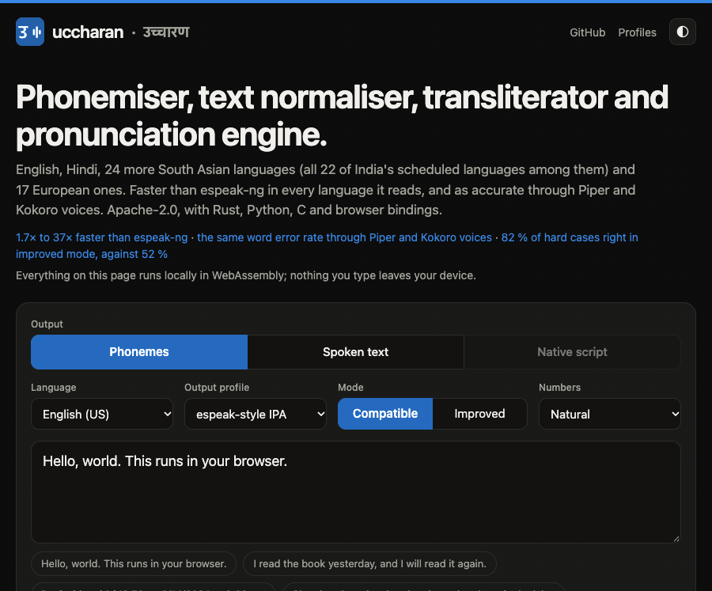

<p align="center">
  <picture>
    <source media="(prefers-color-scheme: dark)" srcset="docs/assets/brand/banner-dark.png">
    <source media="(prefers-color-scheme: light)" srcset="docs/assets/brand/banner-light.png">
    
  </picture>
</p>

<h3 align="center">Phonemiser, text normaliser, transliterator and pronunciation engine.</h3>

<p align="center">
  The text side of text-to-speech and speech recognition in one library: 44 languages,
  in Rust, Python, JavaScript and C. Apache-2.0.
</p>

<p align="center">
  <a href="https://github.com/cB-Sigma/uccharan/actions/workflows/ci.yml"></a>
  <a href="LICENSE"></a>
  <a href="https://pypi.org/project/uccharan/"></a>
  <a href="https://crates.io/crates/uccharan"></a>
  <a href="https://www.npmjs.com/package/uccharan"></a>
</p>

<p align="center">
  <a href="https://cb-sigma.github.io/uccharan/"></a>
</p>

**uccharan** (उच्चारण, "pronunciation") does the text work that sits in front of a neural voice
and behind a speech recogniser:

- as a **phonemiser** it turns text into the phonemes that Piper, Kokoro, Kitten TTS, Matcha-TTS
  and sherpa-onnx voices were trained on, in 44 languages, with output measured against
  espeak-ng's;
- as a **text normaliser** it gives voices that read plain text the spoken form of numbers,
  money, dates, times and URLs, with every change aligned to the input;
- as a **transliterator** it writes romanised Hindi, Marathi, Bengali, Tamil, Telugu, Gujarati,
  Punjabi, Kannada and Malayalam (`aap kaise ho`) in the native script (`आप कैसे हो`);
- as a **pronunciation engine** it applies your word lists to every kind of voice, puts names a
  recogniser misheard back by sound, and labels and checks the data for training voices.

It is written in Rust, has no runtime dependencies, and contains no GPL code or data. Every
accuracy and speed figure below comes from a measurement described in
[docs/evaluation.md](docs/evaluation.md), with its conditions.

<p align="center">
  
</p>

## Install

**Python** (3.9+; Linux, macOS, Windows)

```sh
uv add uccharan          # or, without a project: uv pip install uccharan
pip install uccharan
```

**Rust**

```sh
cargo add uccharan
```

**JavaScript** (browser or Node 18+)

```sh
npm install uccharan
```

**C**: `libuccharan` and `uccharan.h` for Linux, macOS and Windows are attached to each
[release](https://github.com/cB-Sigma/uccharan/releases), or build them with
`cargo build --release -p uccharan-capi`.

With MSVC on Windows, in a Developer Command Prompt in the unpacked release folder (`hello.c`,
`include\`, `lib\`):

```bat
:: against the DLL: link its import library, then keep uccharan.dll next to hello.exe (or on PATH)
cl /nologo /MD /Iinclude hello.c lib\uccharan.dll.lib /Fe:hello.exe
copy lib\uccharan.dll .

:: static: uccharan.lib and the system libraries Rust's standard library uses
cl /nologo /MD /Iinclude hello.c lib\uccharan.lib ntdll.lib synchronization.lib kernel32.lib ^
   userenv.lib ws2_32.lib dbghelp.lib /Fe:hello-static.exe
```

Link statically with `/MD`: `uccharan.lib` is built against the DLL C runtime. Without `ntdll.lib` and
`synchronization.lib` the static link fails with unresolved externals. Built from source, the
system libraries a static link needs are printed by
`cargo rustc --release -p uccharan-capi --lib --crate-type staticlib -- --print native-static-libs`
(the list above is from Rust 1.97, with `synchronization.lib` added).

**Homebrew** (macOS, Linux): the `uccharan` command, `libuccharan` and `uccharan.h`, built from
source

```sh
brew install cb-sigma/tap/uccharan
```

**Language packs**: English and Hindi are built in, and so is every language that needs no word
table, among them the other Indian languages, Bhojpuri, Maithili and Magahi (read with Hindi's
built-in data), Dogri, Bodo, Santali, Manipuri and Kashmiri. Only the word tables of German, Dutch, French,
Italian, Portuguese, Polish, Turkish, Czech, Swedish, Catalan, Romanian, Hungarian, Finnish,
Norwegian, Danish, Urdu and Sindhi are small packs attached to each GitHub release. The wheel and
the npm package download a language's pack the first time it is used, check its SHA-256 sum and
cache it. To install packs ahead of time, or for a machine without network access:

```sh
python -m uccharan.packs                 # list the packs and which are installed
python -m uccharan.packs de fr           # download into the cache
python -m uccharan.packs --dir DIR --all # or into a directory; then set UCCHARAN_DATA_DIR=DIR
```

In Rust, the `download` feature fetches packs on first use and `bundle` compiles every word table
in. See [Packs and their licences](#packs-and-their-licences).

## Thirty seconds of each function

```python
import uccharan

# 1. Phonemes for a voice
uccharan.phonemize("Hello, world.")                          # 'həlˈoʊ, wˈɜːld.'
uccharan.phonemize("नमस्ते दुनिया", "hi")                       # 'nəmˈʌsteː dˈʊnɪjˌaː'
uccharan.phonemize("Guten Morgen, wie geht es dir?", "de")   # 'ɡˈuːtən mˈɔɾɡən, viː ɡˈeːt ɛs dˈiːɾ?'
uccharan.phonemize("Hi there. Bye!", "en-us", "piper")       # ['hˈaɪ ðˈɛɹ.', 'bˈaɪ!']  one string per sentence
uccharan.phonemize("I read it yesterday.", improved=True)    # 'aɪ ɹˈɛd ɪt jˈɛstɚdˌeɪ.'

# 2. The spoken form of a text, for voices that read text
uccharan.normalize("Rs. 250 on 3/4/2024", "en-us").text      # 'two hundred fifty rupees on March fourth twenty twenty four'
uccharan.normalize("₹5 करोड़ का सौदा 10:30 बजे", "hi").text     # 'पांच करोड़ रुपये का सौदा साढ़े दस बजे'

# 3. Romanised text into native script (optional CC BY-SA 4.0 pack, downloaded once)
uccharan.load_pack("xlit-hi")
uccharan.transliterate("mujhe kal office jana hai", "hi").text   # 'मुझे कल office जाना है'

# 4. Your own pronunciations, for every kind of voice
words = uccharan.WordList.from_entries([
    {"word": "Kokoro", "lang": "en", "ipa": "kəkˈɔːɹoʊ"},
    {"word": "SBI", "lang": "hi", "say": "एस बी आई", "match": "case"},
])
uccharan.phonemize_wordlists("Kokoro speaks", "en-us", wordlists=[words])   # 'kəkˈɔːɹoʊ spˈiːks'
uccharan.normalize("SBI में खाता", "hi", wordlists=[words]).text             # 'एस बी आई में खाता'

# 5. Names a speech recogniser misheard, put back by sound
uccharan.match_terms("send it to Coat Harry", ["Kothari"], "en-us")    # [Candidate(text='Coat Harry', term='Kothari', score=0.93, …)]
uccharan.SoundIndex(["Kothari", "Paytm"]).apply("send it to Coat Harry", "en-us").text   # 'send it to Kothari'
```

```sh
# 6. Training data for a voice: phonemes, symbol table and voice.json from a dataset manifest
uccharan-train label metadata.csv -l hi --improved -o labels/
```

The same functions in the other languages:

```rust
use uccharan::normalize_api::{normalize, NormOptions};
use uccharan::soundalike::{ApplyOptions, IndexOptions, SoundIndex};
use uccharan::translit::{transliterate, TranslitOptions};
use uccharan::{Lang, Options, Phonemizer};

let p = Phonemizer::new();
assert_eq!(p.phonemize("Hello, world.", &Options::new(Lang::EnUs)), "həlˈoʊ, wˈɜːld.");

let n = normalize(&p, "₹5 करोड़ का सौदा 10:30 बजे", Lang::Hi, &NormOptions::default());
assert_eq!(n.text, "पांच करोड़ रुपये का सौदा साढ़े दस बजे");

p.load_pack(std::fs::read("xlit-hi.ucd")?)?;          // CC BY-SA 4.0 pack from the release page
let t = transliterate(&p, "aap kaise ho", Lang::Hi, &TranslitOptions::default());
assert_eq!(t.text, "आप कैसे हो");

let index = SoundIndex::from_terms(&p, &["Kothari", "Paytm"], &IndexOptions::default());
let fixed = index.apply(&p, "send it to Coat Harry", Lang::EnUs, &ApplyOptions::default());
assert_eq!(fixed.text, "send it to Kothari");
```

```js
import { phonemize, normalize, loadTranslit, transliterate, createSoundIndex } from "uccharan";

await phonemize("Hello, world.");                                          // "həlˈoʊ, wˈɜːld."
await phonemize("Hi there. Bye!", { profile: "piper" });                   // ["hˈaɪ ðˈɛɹ.", "bˈaɪ!"]
(await normalize("₹5 करोड़ का सौदा 10:30 बजे", { lang: "hi" })).text;        // "पांच करोड़ रुपये का सौदा साढ़े दस बजे"
await loadTranslit("hi", bytesOfXlitHiUcd);                                // CC BY-SA 4.0 pack from the release page
(await transliterate("aap kaise ho", { lang: "hi" })).text;                // "आप कैसे हो"
const index = await createSoundIndex(["Kothari", "Paytm"]);
index.apply("send it to Coat Harry", { lang: "en-us" }).text;              // "send it to Kothari"
```

```c
#include "uccharan.h"

UccharanPhonemizer *p = uccharan_new();
char *ipa = uccharan_phonemize(p, "Hello, world.", "en-us", "espeak-ipa", 0);    /* "həlˈoʊ, wˈɜːld." */
char *spoken = uccharan_normalize(p, "Rs. 250 on 3/4/2024", "en-us", NULL);      /* JSON: text and spans */
UccharanSoundIndex *names = uccharan_sound_index_new(p, "[\"Kothari\", \"Paytm\"]", NULL);
char *fixed = uccharan_match_terms(p, names, "send it to Coat Harry", "en-us", NULL);   /* JSON: text, changes */
uccharan_string_free(ipa); uccharan_string_free(spoken); uccharan_string_free(fixed);
uccharan_sound_index_free(names);
uccharan_free(p);
```

**Command line** (installed with the Python package, `brew install cb-sigma/tap/uccharan`, or
`cargo install uccharan`):
`uccharan -l hi -p piper "नमस्ते दुनिया।"`. Code written for `phonemizer` can use
`from uccharan.compat import EspeakBackend`.

## What is in it

| | What it does | Guide |
| --- | --- | --- |
| [Phonemiser](#phonemiser-and-languages) | text to phonemes in 44 languages, in the shape each voice family expects | [profiles](docs/profiles.md), [languages](docs/languages.md) |
| [Normalise-only mode](#normalise-only-mode) | the spoken form of a text, with typed spans, for voices that read text | [normalize](docs/normalize.md) |
| [Pronunciation word lists](#pronunciation-word-lists) | your pronunciations as TSV, PLS or JSON, applied to phoneme and text voices alike | [word lists](docs/wordlists.md) |
| [Sound-alike matching](#sound-alike-matching) | corrects a recogniser's transcript against your vocabulary by sound | [soundalike](docs/soundalike.md) |
| [Transliteration](#transliteration) | romanised text of nine Indian languages into native script | [transliteration](docs/transliteration.md) |
| [Training tools](#training-tools) | labels datasets, picks reading scripts, reports coverage, scores pronunciation | [training](docs/training.md) |
| [Improved mode and names](#improved-mode-and-names) | pronunciations more correct than the espeak-ng reading, for voices you train yourself | [improved mode](docs/improved-mode.md) |
| [Packs](#packs-and-their-licences) | optional data under its own licence, downloaded only on request | [data licences](DATA_LICENSES.md) |

## Phonemiser and languages

Most open voices (Piper, Kokoro, Kitten TTS, Matcha-TTS, StyleTTS2) were trained on phonemes
from espeak-ng, which is GPL-licensed; sherpa-onnx 2.0 removed espeak-ng for that reason and
expects the caller to bring phonemes. uccharan's **compatible mode** produces those phonemes, so
existing voices work unchanged. espeak-ng is a speech synthesiser; uccharan replaces only its
text-to-phoneme front end, and the neural voice does the speaking.

| Profile | Gives you | For |
| --- | --- | --- |
| `espeak-ipa` | IPA string, words separated by spaces | anything that used `phonemizer`'s espeak backend |
| `piper` | one string per sentence; `piper_ids()` maps it through a voice's `phoneme_id_map` | Piper voices |
| `sherpa-onnx` | one codepoint list per sentence | sherpa-onnx ≥ 2.0 `phoneme_codepoints` |
| `kokoro` | Kokoro tokens; `kokoro_ids()` | Kokoro-82M (English through a built-in port of misaki) |
| `kitten`, `matcha` | phoneme string; `kitten_ids()`, `matcha_ids()` | Kitten TTS 0.8, Matcha-TTS |

**Agreement.** The table gives, for every language, how far compatible mode is from espeak-ng
1.52.0 (called through its library API) on held-out sentences that were never used to write
rules or build tables: the phoneme error rate (PER, edit distance over reference length, stress
marks included), and the same without the sentences that contain digits, because number reading
is where most languages differ most.

**Speed** is uccharan's speed divided by espeak-ng's on those sentences, one thread, both called
as shared libraries from one process, on a shared 4-vCPU machine without a GPU. Plain figures
compare the median (p50) time per sentence; figures marked † compare throughput (words per
second) and are the lower of two runs. The measurements vary by about ±10 % between runs.

| Language | Tag | espeak-ng voice compared with | Held-out text | Phoneme error rate | Without digits | Speed against espeak-ng | Open voices trained on these phonemes |
| --- | --- | --- | --- | ---: | ---: | ---: | --- |
| English (US) | `en-us` | `en-us` | 3,000 sentences | 1.16 % | — | 5.3× | Piper `en_US`, Kokoro (via the misaki port), Kitten TTS, Matcha-TTS |
| English (British, RP) | `en-gb` | `en-gb` | 3,000 sentences | 1.39 % | — | 5.2× | Piper `en_GB`, Kokoro |
| Hindi, and Hindi + English | `hi` | `hi` | 3,000 sentences | 0.09 % | — | 2.8× | Piper `hi_IN`, Kokoro |
| Bengali | `bn` | `bn` | Tatoeba, 2,000 sentences | 0.37 % | — | 2.0× | Piper `bn_BD`, Mimic-3 `bn` |
| Marathi | `mr` | `mr` | Tatoeba, 2,000 sentences | 0.27 % | — | 3.2× | Piper `mr_IN` |
| Telugu | `te` | `te` | FLORES-200, 1,012 sentences | 0.87 % | 0.52 % | 3.0× | Piper `te_IN` (3) |
| Kannada | `kn` | `kn` | FLORES-200, 1,012 sentences | 1.58 % | 0.50 % | 2.4× | MMS / SYSPIN (character input) |
| Malayalam | `ml` | `ml` | FLORES-200, 1,012 sentences | 2.01 % | 0.97 % | 2.6× | Piper `ml_IN` (2) |
| Nepali | `ne` | `ne` | FLORES-200, 1,012 sentences | 2.67 % | 2.32 % | 15× | Piper `ne_NP` (3), Mimic-3 `ne` |
| Tamil | `ta` | `ta` | FLORES-200, 1,012 sentences | 4.09 % | 2.83 % | 37× | Piper `ta_IN` (2, community) |
| Gujarati | `gu` | `gu` | FLORES-200, 1,012 sentences | 2.41 % | 2.04 % | 3.8× | Mimic-3 `gu` |
| Assamese | `as` | `as` | Tatoeba, 2,000 sentences | 7.21 % | — | 2.2× | MMS (character input) |
| Punjabi (Gurmukhi) | `pa` | `pa` | FLORES-200, 1,012 sentences | 0.41 % | 0.22 % | 3.8× | MMS (character input) |
| Odia | `or` | `or` | FLORES-200, 1,012 sentences | 0.50 % | 0.28 % | 2.4× | MMS (character input) |
| Sinhala | `si` | `si` | FLORES-200, 1,012 sentences | 0.86 % | 0.24 % | 2.3× | MMS (character input) |
| Konkani | `kok` | `kok` | Sangraha, 1,000 sentences | 0.20 % | 0.13 % | 5.1× | none |
| Urdu | `ur` | `ur` | FLORES-200, 1,012 sentences | 1.44 % | 1.16 % | 4.0× | Piper `ur_PK` (2) |
| Sindhi | `sd` | `sd` | FLORES-200, 1,012 sentences | 1.30 % | 0.70 % | 2.2× | none |
| Sanskrit | `sa` | `hi` ‡ | FLORES-200, 1,012 sentences | 0.64 % | 0.43 % | 4.2× | none |
| Bhojpuri | `bho` | `hi` ‡ | FLORES-200, 1,012 sentences | 0.51 % | 0.33 % | 3.3× | SYSPIN (character input) |
| Maithili | `mai` | `hi` ‡ | FLORES-200, 1,012 sentences | 0.46 % | 0.29 % | 3.0× | MMS, SYSPIN (character input) |
| Magahi | `mag` | `hi` ‡ | FLORES-200, 1,012 sentences | 0.40 % | 0.23 % | 2.8× | MMS (character input) |
| Dogri | `doi` | `hi` ‡ | IndicCorp v2, 2,000 sentences | 1.40 % | 1.35 % | 1.9× § | none |
| Bodo | `brx` | `hi` ‡ | IndicCorp v2, 2,000 sentences | 0.37 % | 0.32 % | 2.3× § | none |
| Santali (Ol Chiki) | `sat` | none ¶ | IndicCorp v2, 2,000 sentences | — ¶ | — | — ¶ | none |
| Manipuri (Meetei Mayek, Bengali script) | `mni` | none ◊ | IndicCorp v2, 2,000 sentences | — ◊ | — | — ◊ | none |
| Kashmiri (Perso-Arabic, Devanagari) | `ks` | none ※ | IndicCorp v2, 1,678 sentences | — ※ | — | — ※ | none |
| Spanish | `es` | `es` | FLORES-200, 1,012 sentences | 0.54 % | 0.32 % | 2.3× † | Piper `es_ES` (5), Kokoro `ef_dora`, `em_alex`, `em_santa` |
| German | `de` | `de` | FLORES-200, 1,012 sentences | 0.95 % | 0.77 % | 5.8× † | Piper `de_DE` (11) |
| Dutch | `nl` | `nl` | FLORES-200, 1,012 sentences | 1.69 % | 1.32 % | 3.2× † | Piper `nl_NL`, `nl_BE` (11) |
| French | `fr` | `fr` | FLORES-200, 1,012 sentences | 0.63 % | 0.54 % | 5.9× † | Piper `fr_FR` (7), Kokoro `ff_siwis` |
| French (Belgium) | `fr-be` | `fr-be` | FLORES-200, 1,012 sentences ✦ | 0.63 % | 0.54 % | 5.9× † | none |
| French (Switzerland) | `fr-ch` | `fr-ch` | FLORES-200, 1,012 sentences ✦ | 0.62 % | 0.54 % | 5.9× † | none |
| Italian | `it` | `it` | FLORES-200, 1,012 sentences | 0.53 % | 0.37 % | 4.6× † | Piper `it_IT` (4), Kokoro `if_sara`, `im_nicola` |
| Portuguese (Brazil) | `pt-br` | `pt-br` | FLORES-200, 1,012 sentences | 0.61 % | 0.40 % | 5.1× † | Piper `pt_BR` (4), Kokoro `pf_dora`, `pm_alex`, `pm_santa` |
| Portuguese (Portugal) | `pt` | `pt` | FLORES-200, 1,012 sentences | 0.84 % | 0.60 % | 5.2× † | Piper `pt_PT` (1) |
| Polish | `pl` | `pl` | FLORES-200, 1,012 sentences | 1.12 % | 0.92 % | 3.1× † | Piper `pl_PL` (5) |
| Turkish | `tr` | `tr` | FLORES-200, 1,012 sentences | 0.68 % | 0.47 % | 2.7× † | Piper `tr_TR` (1) |
| Czech | `cs` | `cs` | FLORES-200, 1,012 sentences | 1.31 % | 1.07 % | 1.8× † | Piper `cs_CZ` (3) |
| Swedish | `sv` | `sv` | FLORES-200, 1,012 sentences | 1.32 % | 0.83 % | 3.7× † | Piper `sv_SE` (3) |
| Catalan | `ca` | `ca` | FLORES-200, 1,012 sentences | 1.44 % | 1.10 % | 4.9× † | Piper `ca_ES` (3) |
| Romanian | `ro` | `ro` | FLORES-200, 1,012 sentences | 0.96 % | 0.86 % | 3.3× † | Piper `ro_RO` (1) |
| Hungarian | `hu` | `hu` | FLORES-200, 1,012 sentences | 1.34 % | 0.95 % | 13.1× † | Piper `hu_HU` (3) |
| Finnish | `fi` | `fi` | FLORES-200, 1,012 sentences | 1.36 % | 1.08 % | 1.7× † | Piper `fi_FI` (2) |
| Norwegian Bokmål | `nb` | `nb` | FLORES-200, 1,012 sentences | 0.96 % | 0.46 % | 2.3× † | Piper `no_NO` (2) |
| Danish | `da` | `da` | FLORES-200, 1,012 sentences | 1.95 % | 1.49 % | 27.1× † | Piper `da_DK` (1) |

✦ The Belgian and Swiss French voices are scored on the French sentences; they differ from the
French reading only in the numbers 70–99 (septante, huitante, nonante). Their speed is the French
voice's: in one run on a busy machine French 4.5×, `fr-be` 4.5×, `fr-ch` 5.2×.

‡ espeak-ng has no voice for Sanskrit, Bhojpuri, Maithili, Magahi, Dogri or Bodo; text in them is read
with its Hindi voice, and compatible mode is measured against that reading. Improved mode reads
them as themselves (below).

§ Measured on a Windows 11 laptop, not on the machine of the other rows (500 held-out sentences,
p50, best of 5 rounds); in the same run as Dogri, Magahi gave 2.3× and Hindi 1.8×, against 2.8× each
in the table; in the same run as Bodo, Dogri gave 1.9× and Hindi 1.8×. Bodo's second held-out set,
the 1,012 FLORES-200 sentences of Google's IndicGenBench, gives 0.48 % (0.35 % without stress).

¶ espeak-ng cannot read Santali's Ol Chiki script: under every voice it says the code point of each
letter. With no reference reading there is no phoneme error rate and no speed ratio; both modes give
uccharan's Santali reading, checked on a hand-written gold set (below). On the § laptop, 500
held-out sentences, one thread: 16.7 µs per sentence (p50), 0.72 million words per second; in the
same run Bodo gave 2.4× espeak-ng's speed and Hindi 1.8×. Every Ol Chiki word of the four held-out
sets (IndicCorp v2, IndicGenBench, Santali Wikipedia, Tatoeba) is read to Santali phonemes
([notes](docs/languages.md#notes-on-the-languages)).

◊ Manipuri (Meitei) is read in both its scripts: Meetei Mayek by its own language file, Bengali-script
Meitei through the Meetei Mayek it spells letter for letter. espeak-ng has no Meitei voice (`bpy` is
Bishnupriya Manipuri, another language) and cannot read Meetei Mayek, so both modes give uccharan's
reading, checked on a gold set of Wiktionary pronunciations and hand-written sentences (below). Its
Bengali voice is no reference for Bengali-script Meitei: on the Bengali-script half of the held-out
gold set it gets 28.9 % of 83 words (sentence PER 23.3 %), against 95.2 % (0.52 %) for uccharan. On
the § laptop, 500 held-out Meetei Mayek sentences, one thread: 14.2 µs per sentence (p50), 0.55
million words per second; in the same run Bodo gave 2.4× espeak-ng's speed and Hindi 1.8×. Every
word of the held-out sets (IndicCorp v2 and Manipuri Wikipedia in Meetei Mayek, IndicGenBench in
Bengali script) is read ([notes](docs/languages.md#notes-on-the-languages)).

※ Kashmiri is read in both its scripts: the Perso-Arabic of its official orthography, which writes
nearly every vowel, by its own language file, and Devanagari through the Perso-Arabic spelling it
corresponds to. espeak-ng has no Kashmiri voice, so both modes give uccharan's reading, checked on a
gold set of Wiktionary pronunciations and hand-written sentences (below). espeak-ng's Urdu and Hindi
voices read Kashmiri as Urdu and Hindi: on the held-out gold set they get 27.9 % of 455 Perso-Arabic
and 30.5 % of 190 Devanagari words, against 95.8 % and 92.6 % for uccharan. On the § laptop, 500
held-out sentences, one thread: 15.0 µs per sentence (p50), 0.68 million words per second; in the
same run Bodo gave 2.4× espeak-ng's speed and Hindi 1.8×. Every word of the held-out sets
(IndicCorp v2, Kashmiri Wikipedia) is read ([notes](docs/languages.md#notes-on-the-languages)).

How to read it:

- **Tatoeba and FLORES-200 rows are not comparable.** FLORES-200 is longer news text with many
  numbers and names; Tatoeba is short everyday sentences.
- **Words outside the word tables are where the errors are.** The sixteen European languages
  after Spanish use a word table plus a letter-to-sound model, both made by running espeak-ng
  1.52.0 over word lists from Tatoeba and the Leipzig Corpora Collection. On the held-out text,
  words outside those lists are wrong far more often than listed ones: from 2.0 % (Hungarian)
  and 9.2 % (Czech) to 49.0 % (European Portuguese) and 62.3 % (Danish) of such words. Each
  language's figures are in [docs/languages.md](docs/languages.md).
- **Assamese (7.21 %), Tamil (4.09 %) and Nepali (2.67 %) are furthest from espeak-ng**; the
  reasons are in the language notes.
- **Czech and Finnish are the slowest** against espeak-ng (1.8× and 1.7×): their texts have many
  distinct word forms, and each new form goes through the letter-to-sound model.
- **Voices.** End to end (voice plus speech recogniser, 200 to 500 held-out sentences per voice)
  the word error rate with uccharan's phonemes is within the confidence interval of espeak-ng's
  for the voices tried: Piper `amy-low` 2.94 % → 2.97 %, `lessac-medium` 4.30 % → 4.21 %,
  `alba-medium` 7.36 % → 7.47 %, `hi_IN-rohan-medium` 8.95 % → 8.82 %, `es_ES-davefx-medium`
  13.23 % → 12.90 %, `de_DE-thorsten-medium` 21.76 % → 20.99 %, `fr_FR-siwis-medium` 19.28 % →
  19.39 %, `it_IT-paola-medium` 30.02 % → 29.91 % (a small recogniser), and three Kokoro
  speakers. That is eight Piper voices (English, Hindi, Spanish, German, French, Italian) and one
  Kokoro speaker each for American English, British English and Hindi; no voice of the other
  languages has been run end to end
  ([details](docs/evaluation.md#2-end-to-end-real-voices-real-speech-recognition)).
- **Kokoro English** does not go through espeak-ng: uccharan carries a port of misaki, the front
  end Kokoro was trained on, with misaki 0.9.4's dictionaries. It gives the same tokens as misaki
  for 94.9 % of held-out sentences (99.96 % of dictionary words) and takes 21 µs per sentence
  against misaki's 1.88 ms ([details](docs/evaluation.md#6-kokoro)).

English and Hindi in absolute terms, same method (3 000 held-out sentences, best of 11 rounds,
each round in a fresh process): 11.8 µs per sentence against espeak-ng's 62.1 µs for American
English (p50), 5.5 µs against 15.7 µs for Hindi; 580 k words per second on one thread against
114 k; start-up plus the first sentence in 0.65 ms against 4.0 ms. Where uccharan does **not**
win is size: its library code is larger than espeak-ng's, and its English data compresses worse
(604 KB against 380 KB with xz).
The full tables, including WebAssembly, are in
[docs/evaluation.md](docs/evaluation.md#5-speed-start-up-memory-and-size).

Per-language notes, the number and clause rules each language follows, and how to add one:
[docs/languages.md](docs/languages.md), [docs/adding-a-language.md](docs/adding-a-language.md).

## Normalise-only mode

Voices that read text instead of phonemes (Indic Parler-TTS, IndicF5, Chatterbox, VoxCPM2, Veena
and other LLM-based models) still need numbers, money, dates, times, phone numbers and URLs
written out. `normalize` returns that spoken form with typed spans (number, money, date, time,
phone, URL, Latin word in Indic text, …) aligned to the input in byte, code-point and UTF-16
offsets. Options choose which language reads digits, lakh/crore or international grouping in
English, whether Latin words are kept, respelled in the script or spelled out, and whether URLs
are read.

```python
uccharan.normalize("UPI से भुगतान", "hi", latin="transliterate").text   # 'यू पी आई से भुगतान'
```

It uses the same number, date and currency readers as the phonemiser, for every language the
phonemiser has. See [docs/normalize.md](docs/normalize.md).

## Pronunciation word lists

One list of your names, brands and jargon serves every voice: phoneme voices get an entry's IPA
converted to their phone set, text voices get its spoken form, or a respelling chosen by reading
candidates back with uccharan's own phonemiser. Lists are tab-separated text with the columns
`word lang ipa say match note`, or JSON, or W3C PLS (import and export); matching is by whole
word, by case, by exact substring or by regular expression. See
[docs/wordlists.md](docs/wordlists.md).

## Sound-alike matching

A recogniser writes a name it does not know as the nearest words it does know: "Kothari" as
*Coat Harry*, "Paytm" as *pay tm*. `match_terms` and `SoundIndex` compare a transcript with your
vocabulary as phonemes and put the terms back. Close sounds are cheap to exchange (voicing,
aspiration, vowel length, retroflex / dental), unrelated ones are not, and because everything is
phonemes a Latin-script vocabulary matches a Devanagari transcript and the other way round.
Every change is reported; none is silent.

Held-out, with 651 terms (Indian names, brands, technical and domain terms) in English, Hindi
and Hinglish sentences spoken by synthetic voices and transcribed by small recognisers: at the
default thresholds 43.9 % of the terms the recognisers got wrong are put back (64.2 % in English
sentences), 97.8 % of the corrections are right, and 2 of 775 sentences without any term are
changed. Character edit distance puts back 8.8 % (and changes 7 of those sentences); Metaphone
codes 18.7 % while changing 38 % of them. About 7 800 transcripts a second against 1 000 terms
and 300 against 50 000. The speech in this test is synthetic; human speakers and larger
recognisers were not measured. See
[docs/soundalike.md](docs/soundalike.md) and
[the evaluation](docs/evaluation.md#7-sound-alike-matching).

## Transliteration

People type `aap kaise ho` or `mujhe kal office jana hai`; voices and recognisers do better with
`आप कैसे हो` and `मुझे कल office जाना है`. `transliterate` writes the romanised words of **Hindi,
Marathi, Bengali, Tamil, Telugu, Gujarati, Punjabi, Kannada or Malayalam** in the language's
script, leaves English words as English (or respells them in the script on request), and returns
spans aligned to the source with the alternatives of each word. Each word gets candidates from a
lexicon of attested spellings and from a small n-gram model; they are ranked by the model, by
word frequency and by how alike the romanised word and the candidate *sound*. There is no neural
network to run: a word it has never seen takes about a third of a millisecond.

**Hindi mixed with English** (164 hand-written chat sentences, 868 Hindi and 130 English words,
held out):

| | Hindi words written correctly | English words converted by mistake | Hindi words left in Latin letters |
| --- | ---: | ---: | ---: |
| First run on the held-out set (the clean figure) | **95.9 %** | 7.7 % | 0.3 % |
| The pack that ships, scored again after a fix prompted by that run | **98.2 %** | 7.7 % | 0.3 % |
| Without a pack (built-in list and rules) | 72.4 % | 3.1 % | 20.0 % |

The first run showed that vowel-less chat spellings (`nhi`, `kr`, `h`) were being overruled; that
was fixed on new development sentences and the packs were rebuilt. The 98.2 % was therefore
obtained after a change made in response to held-out errors and is optimistic; 95.9 % is the
figure from the one run made before it. (Spelling variants of one word, such as हिन्दी / हिंदी,
count as correct in both; exact match is 93.1 % and 95.2 %.)

**Single words, first candidate right (%)**, held-out, next to the figures published for
IndicXlit, AI4Bharat's neural transliterator (taken from its README on 2026-11-14, not re-run
here, so small differences of protocol are possible):

| Language | Pack | Dakshina test: uccharan | IndicXlit | Aksharantar native words: uccharan | IndicXlit | Aksharantar named entities: uccharan | IndicXlit |
| --- | ---: | ---: | ---: | ---: | ---: | ---: | ---: |
| Hindi | 8.7 MB | **68.69** | 60.56 | 49.66 | **55.59** | 57.04 | **58.87** |
| Marathi | 7.4 MB | **74.45** | 64.85 | 57.08 | **63.72** | 52.55 | **53.57** |
| Bengali | 7.8 MB | **67.09** | 55.49 | 60.65 | **61.70** | **46.42** | 37.12 |
| Tamil | 7.0 MB | **75.90** | 68.10 | **72.65** | 69.78 | 38.81 | **42.12** |
| Telugu | 7.0 MB | **81.45** | 73.38 | 83.88 | **84.69** | **53.38** | 51.82 |
| Gujarati | 6.0 MB | **65.62** | 62.02 | 54.72 | **61.89** | **49.67** | 48.89 |
| Punjabi | 3.1 MB | **53.34** | 47.24 | 34.43 | **40.27** | 34.05 | **36.08** |
| Kannada | 6.7 MB | **84.40** | 77.18 | 75.68 | **76.18** | 48.64 | **49.92** |
| Malayalam | 6.4 MB | **71.66** | 63.56 | 61.62 | **64.73** | 30.90 | **33.93** |

uccharan is ahead on the Dakshina test words in all nine languages (by 3.6 to 11.6 points),
**behind** on Aksharantar's native words in eight (by 0.5 to 7.2 points; ahead in Tamil), and on
named entities ahead in three and behind in six. The Dakshina words were sampled from Wikipedia
and part of uccharan's frequency list is Wikipedia text, so that set is the favourable case and
the Aksharantar native words the unfavourable one. Outside Hindi the choice between English and
the language is not measured (there is no code-mixed test set for the other eight languages),
and their hand-written chat-spelling and homograph lists have not been reviewed by native
speakers.

The data is one optional pack per language under CC BY-SA 4.0 (see
[Packs](#packs-and-their-licences)); without a pack the function converts by rule, far less
accurately. See [docs/transliteration.md](docs/transliteration.md) and
[the evaluation](docs/evaluation.md#8-romanised-text-into-native-script).

## Training tools

`uccharan.train` (Python) and the `uccharan-train` command are for people who train voices and
check pronunciation. Nothing in them reads audio.

```sh
uccharan-train label metadata.csv -l hi --improved -o labels/        # phonemes for Piper, Matcha-TTS, icefall
uccharan-train select corpus.txt -l bho --improved -n 500 -o script/ # what to record
uccharan-train coverage labels/labels.jsonl -l hi --reference corpus.txt --alignments aligned/
uccharan-train score -l hi --reference "मेरा घोड़ा तेज़ है" --heard "मेरा कीड़ा तेज़ है"
uccharan-train mfa-dict corpus.txt -l bho -o bho.dict                # dictionary for a forced aligner
```

- **Labelling** turns a manifest (LJSpeech `metadata.csv`, JSON lines, Hugging Face rows) into
  Piper's `--data.phoneme_type text` CSV, a phoneme-id CSV and id map, Matcha-TTS filelists,
  `tokens.txt` and token lists for icefall-style recipes, and a `voice.json` that records the
  uccharan version, mode, profile and language the voice must be driven with. Symbols outside a
  target table are reported, and each utterance gets warnings for unknown characters, unread
  numbers and mixed scripts. Word lists apply.
- **Script selection** picks the few sentences that cover every phone and as many diphones as
  possible.
- **Coverage** counts phones and diphones, lists what a dataset lacks against a reference
  corpus, gives the duration per phone from alignments, and names outlier utterances.
- **Scoring** aligns a reference with a recogniser's text or a phone recogniser's output using
  the weighted phoneme distance of the sound-alike matcher, and reports the error rate, a score
  per word, and the words that were mispronounced, missing or extra.

The file layouts were checked against the Piper, Matcha-TTS, icefall and Montreal Forced Aligner
sources and documentation; **no voice has been trained with them yet**. See
[docs/training.md](docs/training.md) and the [example](examples/train).

## Improved mode and names

Compatible mode reproduces the espeak-ng reading, mistakes included, because that is what
existing voices learned. **Improved mode** (`improved=True`) is for voices you train yourself, and
for word lists and scoring: homographs in context, names, numbers, dates and units, Hindi schwa
deletion and nasals, and the languages espeak-ng reads with its Hindi voice read as themselves.
Scores on hand-written sets whose expected pronunciations come from dictionaries and standard
phonology, never from a phonemiser; each set was written after the rules it tests were frozen or
before the work on them began, and the figures are for held-out items:

| Held-out set | espeak-ng 1.52 | uccharan compatible | uccharan improved |
| --- | ---: | ---: | ---: |
| English homographs, proper nouns, numbers; Hindi schwa and nasals; romanised Hindi (128 items) | 51.6 % | 48.4 % | **82.0 %** |
| Personal names of many origins (172) | 61.6 % | 80.2 % | **91.3 %** |
| — Indian names (48) | 43.8 % | 50.0 % | **79.2 %** |
| — names not in CMUdict (41) | 34.1 % | 19.5 % | **68.3 %** |
| African names (195) | 45.6 % | 41.5 % | **75.9 %** |
| North African names (100) | 40.0 % | 33.0 % | **66.0 %** |
| Egyptian names (85) | 56.5 % | 48.2 % | **69.4 %** |
| Chichewa, Shona, Tsonga and Tigrinya names (96) | 47.9 % | 31.2 % | **76.0 %** |
| Bhojpuri words (224) | 62.9 % | 63.8 % | **96.4 %** |
| Maithili words (226) | 68.6 % | 66.4 % | **93.4 %** |
| Magahi words (270) | 64.4 % | 70.0 % | **98.5 %** |
| Dogri words (70) | 44.3 % | 44.3 % | **97.1 %** |
| Bodo words (79) | 2.5 % | 2.5 % | **98.7 %** |
| Santali words (100) ¶ | — | **100.0 %** | **100.0 %** |
| Manipuri words, Meetei Mayek (193) ◊ | — | **92.2 %** | **92.2 %** |
| Manipuri words, Bengali script (83) ◊ | 28.9 % (`bn` voice) | **95.2 %** | **95.2 %** |
| Kashmiri words, Perso-Arabic (455) ※ | 27.9 % (`ur` voice) | **95.8 %** | **95.8 %** |
| Kashmiri words, Devanagari (190) ※ | 30.5 % (`hi` voice) | **92.6 %** | **92.6 %** |

What these do and do not show: for names that are in CMUdict the reference *is* CMUdict, which
uccharan's lexicon comes from, so the fair rows are Indian names and names not in CMUdict. The
North African, Egyptian and Chichewa / Shona / Tsonga / Tigrinya sets were scored twice (the table
gives the second scoring; the first is in the evaluation). The Bhojpuri, Maithili, Magahi, Dogri, Bodo and Santali sets mostly encode grammars' descriptions as
written down for this project, so they show that improved mode implements them, not that a
native speaker would accept every form (the Manipuri and Kashmiri words come with Wiktionary's
pronunciations instead, and miss where Wiktionary's vowel is not the one the letters write)
([items to check](docs/bhojpuri-maithili-review.md)). On the 348 development items improved mode
scores 99.7 %, which only shows the rules do what they were written to do. Full tables:
[docs/evaluation.md](docs/evaluation.md#4-correctness-improved-mode-against-hand-curated-gold-sets);
what improved mode changes: [docs/improved-mode.md](docs/improved-mode.md).

## Packs and their licences

The packages (crate, wheel, npm package, C library) are Apache-2.0 and carry only data that is
Apache-2.0 or BSD-licensed. Data under a **share-alike** licence is kept out of them: it ships as
separate files attached to each [GitHub release](https://github.com/cB-Sigma/uccharan/releases),
and nothing downloads it unless you ask.

| Pack | What it is | Size | Licence | In the packages? |
| --- | --- | ---: | --- | --- |
| `en-us`, `en-gb`, `hi` | English lexicons and letter-to-sound models, Hindi exceptions | 0.7 MB, 0.7 MB, 3 KB | Apache-2.0 (includes CMUdict, BSD-2-Clause) | yes (the wheel fetches `en-gb` on first use) |
| `de`, `nl`, `fr`, `it`, `pt-br`, `pt`, `pl`, `tr`, `cs`, `sv`, `ca`, `ro`, `hu`, `fi`, `nb`, `da`, `ur`, `sd` | word table of the language: a letter-to-sound model and its exceptions | 46 KB to 0.66 MB each, 4.2 MB together | Apache-2.0 | **fetched the first time the language is used** (wheel, npm package; crate with the `download` feature), or compiled in with the crate's `bundle` feature |
| `kokoro-en-us`, `kokoro-en-gb` | misaki 0.9.4's English dictionaries, for the `kokoro` profile | 1.9 and 2.1 MB | Apache-2.0 | crate and C library yes; wheel and npm fetch them on first use |
| `wikipron-en-us`, `wikipron-en-gb`, `wikipron-hi` | Wiktionary pronunciations (80.8 k, 81.3 k and 30.4 k words) for improved mode's words outside the built-in lexicon | 0.3 to 0.7 MB | **CC BY-SA 4.0** (Wiktionary contributors, via WikiPron) | **no**: on request only |
| `xlit-hi`, `xlit-mr`, `xlit-bn`, `xlit-ta`, `xlit-te`, `xlit-gu`, `xlit-pa`, `xlit-kn`, `xlit-ml` | transliteration model, spelling lexicon and word counts per language | 3.1 to 8.7 MB, 60 MB together | **CC BY-SA 4.0** (trained on the Dakshina and Aksharantar word pairs; counts from corpora that include Wikipedia text) | **no**: on request only |

```python
uccharan.load_pack("xlit-hi")              # downloads from the release of the installed version, checks SHA-256, caches
uccharan.load_pack("/path/to/xlit-hi.ucd") # or a file you fetched yourself
```

Downloads are checked against SHA-256 sums built into the package and cached in
`~/.cache/uccharan/<version>/`. A language is never read without its word table: when the pack
cannot be had, Python raises `PackError`, the C calls return NULL with the reason in
`uccharan_last_error()`, Rust's `Phonemizer::ensure` returns the error, and the synchronous
JavaScript calls throw; each message names the pack and its URL.

Offline: fetch the files once (`python -m uccharan.packs --dir DIR de fr ur`, or `--all`, or take
them from the release page), name the directory in `UCCHARAN_DATA_DIR` and set
`UCCHARAN_OFFLINE=1`. In Rust, `features = ["bundle"]` compiles every word table in and
`features = ["download"]` fetches on first use; without either, the tables are read from
`UCCHARAN_DATA_DIR` or the cache. In Rust and C, `load_pack` also takes a file's bytes; in
JavaScript, the npm package carries the files and loads each on first use, and `loadTranslit` and
`loadWikipron` take the bytes or read the file from the data directory.
Compatible mode never uses the WikiPron packs. Every file, its source and its licence are listed
in [DATA_LICENSES.md](DATA_LICENSES.md).

## What is not tested

- Voices of the languages other than English, Hindi, Spanish, German, French and Italian end to
  end (Telugu, Marathi, Bengali and Urdu had no offline voice or recogniser that works); en-GB and Hindi on more
  than one Piper voice each; Kokoro on more than one speaker per language.
- Kitten TTS and Matcha-TTS end to end (only symbol tables and framing are checked).
- The `piper` command-line program (it embeds espeak-ng and has no hook) and running Piper voices
  directly with onnxruntime.
- A human listening test, and review by native speakers of most languages. The transliteration
  lists for eight of the nine languages are unreviewed.
- The choice between English and the language in transliteration, for any language but Hindi.
- Sound-alike matching on human speech and with large recognisers.
- Training a voice from the files `uccharan-train label` writes, an aligner run with the exported
  dictionary, and pronunciation scores against human judgements.
- Multi-core scaling beyond about two cores, and speed on any machine but the shared one the
  figures come from.
- Side-by-side speed against espeak-ng's WebAssembly build.
- macOS beyond the test suite, which runs there on every change. Windows was also run on one Windows 11
  laptop (Ryzen 7 5800H): the Python and Rust tests passed, the command line read UTF-16 input from
  Notepad and PowerShell, and the C library linked with MSVC; Hindi took 8.7 µs p50 per sentence there
  against 5.5 µs on the Linux machine ([evaluation](docs/evaluation.md)). Agreement figures come from
  Linux only.

## Licence

Apache-2.0. Includes data from the CMU Pronouncing Dictionary (BSD-2-Clause) and misaki
(Apache-2.0); see [NOTICE](NOTICE). [DATA_LICENSES.md](DATA_LICENSES.md) lists every data file
with its source and licence. The optional `wikipron-*` and `xlit-*` packs are CC BY-SA 4.0; they
are not part of any package and are loaded only on request.

uccharan contains no espeak-ng code, rules or dictionary data. The Kokoro English front end is a port
of misaki's Apache-2.0 code and ships misaki 0.9.4's English dictionaries unchanged under their
upstream Apache-2.0 licence statement; upstream does not document where the dictionary entries
originally come from (details in [DATA_LICENSES.md](DATA_LICENSES.md)).

## Documentation

[Languages](docs/languages.md) · [Profiles](docs/profiles.md) ·
[Evaluation](docs/evaluation.md) · [Improved mode](docs/improved-mode.md) ·
[Normalise-only mode](docs/normalize.md) · [Word lists](docs/wordlists.md) ·
[Sound-alike matching](docs/soundalike.md) ·
[Transliteration](docs/transliteration.md) ·
[Training voices and checking pronunciation](docs/training.md) ·
[Architecture](docs/architecture.md) · [Adding a language](docs/adding-a-language.md) ·
[How it compares with other phonemisers](docs/comparison.md) ·
Integrations: [sherpa-onnx](docs/integrations/sherpa-onnx.md), [Piper](docs/integrations/piper.md),
[Kokoro](docs/integrations/kokoro.md), [bolo](docs/integrations/bolo.md) ·
[Contributing](CONTRIBUTING.md) · [Changelog](CHANGELOG.md) · [Security](SECURITY.md)

uccharan is a sibling of [bolo](https://github.com/cB-Sigma/bolo-speech). Made by Abhinav Gautam.
